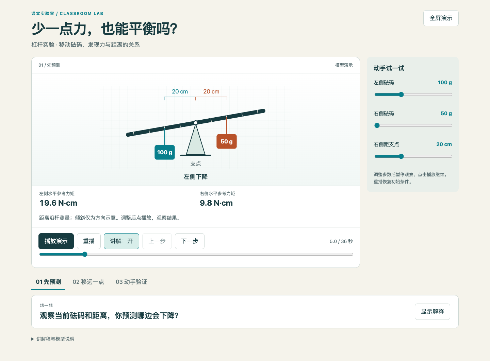
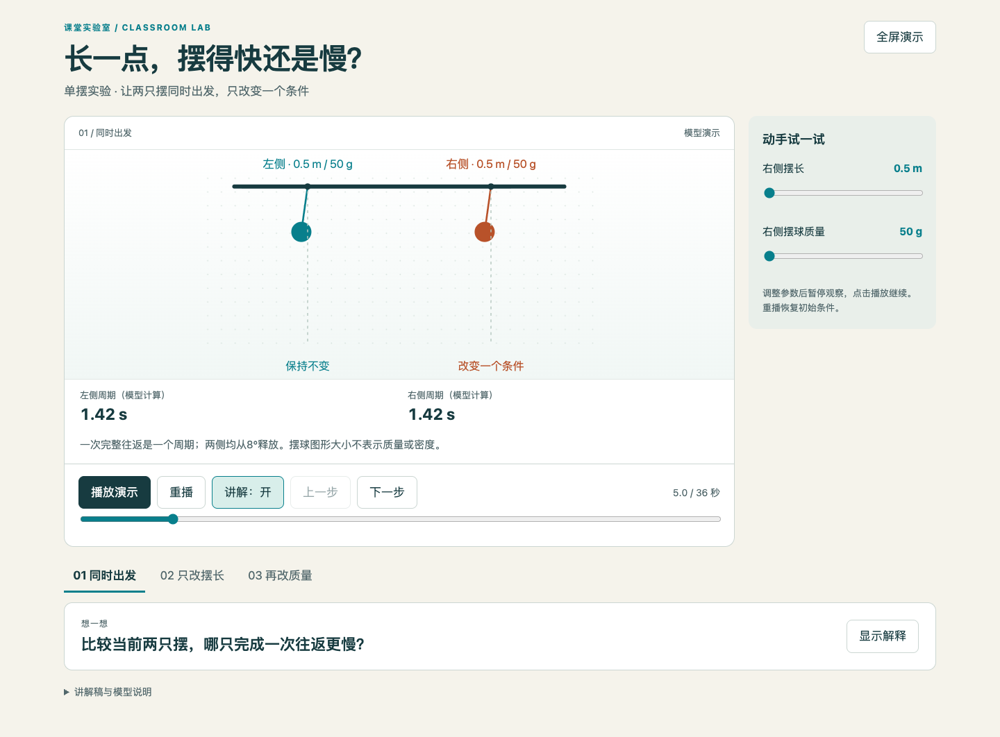
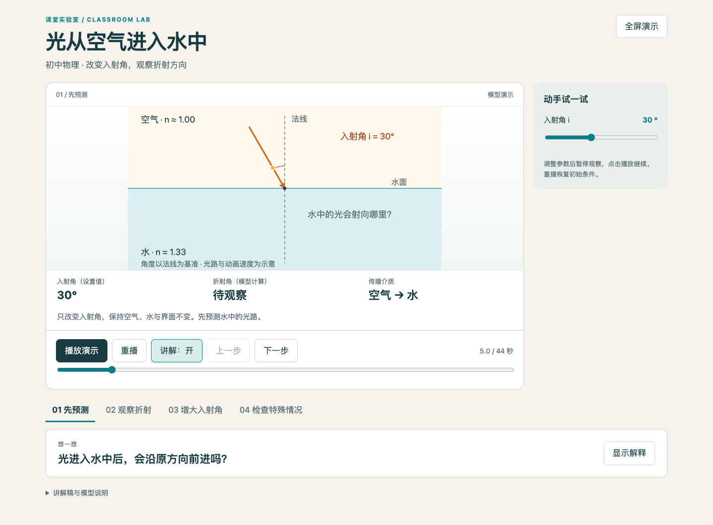

<div align="center">

# 课堂实验动画

### 说出实验，让课堂里的变化动起来。

一个面向教师的 AI Skill：用一句话，生成**带中文讲解、可以互动、能够离线播放**的实验动画。

[在线体验](https://xiao-class.github.io/classroom-lab/) · [安装 Skill](#安装-skill) · [开始使用](#开始使用) · [验证说明](VALIDATION.md)

</div>



> “做一个杠杆平衡的实验动画，让学生先猜，再移动砝码验证。”
>
> AI 制作实验画面、讲解和交互，交付一个网页。打开，点播放，就能演示。

## 先看效果

**无需安装，直接体验三个带讲解的示例。** 点“播放演示”开始；也可以暂停、分步查看、拖动滑块，再显示解释。

| 杠杆平衡 | 单摆的周期 | 光的折射 |
| :---: | :---: | :---: |
| [](https://xiao-class.github.io/classroom-lab/examples/lever/) | [](https://xiao-class.github.io/classroom-lab/examples/pendulum/) | [](https://xiao-class.github.io/classroom-lab/examples/refraction/) |
| 改砝码、移距离，观察平衡条件 | 分别改变摆长和质量，进行对照 | 改变入射角，观察折射方向 |
| [打开演示 →](https://xiao-class.github.io/classroom-lab/examples/lever/) | [打开演示 →](https://xiao-class.github.io/classroom-lab/examples/pendulum/) | [打开演示 →](https://xiao-class.github.io/classroom-lab/examples/refraction/) |

也可以[下载整个项目](https://github.com/xiao-class/classroom-lab/archive/refs/heads/main.zip)，解压后打开 `index.html`，离线播放。GitHub 仓库里的 HTML 文件页面显示源码；请使用上面的演示链接，或下载后打开。

## 安装 Skill

### 在 Codex 中，一句话安装

把下面这段话发给 Codex：

```text
请用 skill-installer 安装这个课堂实验动画 Skill：
https://github.com/xiao-class/classroom-lab
Skill 位于 skills/classroom-lab 目录。
```

安装后输入 `$classroom-lab`，检查是否能选中。没有出现时，重启 Codex 再查看。

<details>
<summary>手动安装 / 其他 AI 助手</summary>

下载仓库，把完整的 `skills/classroom-lab` 文件夹放入 Codex 的用户 Skill 目录 `~/.agents/skills/`。模板、脚本和资源都要保留，不能只复制 `SKILL.md`。如果已有同名 Skill，先比较版本，保留自己的修改。

其他工具请按照它们支持的 Skill 安装方式操作。需要助手具备读取本地 Skill、生成文件和运行代码的能力；普通聊天窗口不一定能够使用。当前实际验证环境是 Codex，未逐一测试其他助手。

安装目录与发现机制参考 [OpenAI Skill 文档](https://learn.chatgpt.com/docs/build-skills)，核对日期：2026-10-20。

</details>

## 开始使用

安装好之后，直接说：

```text
用 $classroom-lab 做一个量筒读数实验动画。
```

也可以加一句课堂要求：

```text
演示光从空气进入水中的折射，给初二学生看。

做一个浮力实验动画，让学生先猜，再看结果。

做一个杠杆实验，先别显示答案，让学生移动砝码试一试。
```

不用先写完整教案，也不用填参数表或选择音色。默认交付中文、有普通话讲解的独立网页；年级、时长、风格等已有要求会优先采用。

拿到动画后还可以继续说：

| 你说 | 可以调整什么 |
| --- | --- |
| “慢一点，给学生留时间观察” | 演示节奏与阶段停顿 |
| “给四年级学生看” | 讲解方式和内容难度 |
| “先不要显示答案” | 提问与解释的出现顺序 |
| “换一组数据再演示” | 模型参数与对应讲解 |

## 你会得到什么

- **可直接打开的网页**：播放、暂停、重播、分步查看，默认无需服务器。
- **随实验推进的讲解**：默认使用微软普通话女声“晓晓”，可一键关闭。
- **有意义的互动**：适合调参的实验提供滑块，图形和数值跟随变化。
- **讲解稿和模型说明**：便于备课，也说明哪些数值属于模型计算。
- **可继续修改的源文件**：继续用自然语言提出修改即可。

手动改变参数时，示例会暂停固定讲解，避免声音仍在讲旧条件。重播或进入预设步骤后可以恢复讲解。

## 常见问题

**需要老师编程吗？**  
不用。代码、配音和文件构建由 AI 助手处理。制作仍需要一个具备相应能力的 AI 工具和可执行环境。

**需要配音 Key、录音或部署声音模型吗？**  
默认“晓晓”方案不需要。助手通过 [edge-tts](https://github.com/rany2/edge-tts) 在线生成讲解，准备所需依赖并嵌入网页。生成时需要联网，会将讲解文字发送到语音服务；生成后的网页可离线播放。在线服务可能因网络或服务变化不可用，助手应明确说明，不能把无声结果称为有声完成。

**只能做这三个实验吗？**  
这三个是已验证的示例。Skill 会根据新实验编写对应模型，并核对科学关系；不保证所有学科、所有题目都能一次生成正确结果。

**能直接放进 PPT 或导出视频吗？**  
当前默认交付网页，没有一键 MP4 或原生可编辑 PPTX 导出。网页、视频和 PPTX 是不同格式，需要分别制作和验证。

**可以代替真实实验吗？**  
它适合课堂演示、预测和对照观察。涉及真实操作时，仍需遵守实验规范与现场指导。模型计算不能冒充实测数据。

## 验证到哪里了

已验证杠杆、单摆和折射三个物理案例，包括模型计算、主要交互、手机尺寸布局、离线资源和讲解播放。最新音频也完成了解码、时长和内嵌检查。

目前尚未进行真实教师课堂、全部浏览器和所有学科验证。各版本实际检查过什么、没有检查什么，见 [VALIDATION.md](VALIDATION.md)。

发现问题时，可以[提交 Issue](https://github.com/xiao-class/classroom-lab/issues)，附上实验名称、原始要求、浏览器和复现方式。

<details>
<summary>开发者：源码结构与检查命令</summary>

```text
skills/classroom-lab/  可安装的完整 Skill
examples/             三个实验示例
index.html            在线 / 本地演示入口
tests/                开发者测试
qa/                   验证记录与截图
```

杠杆可修改源文件在 `skills/classroom-lab/assets/lever-demo/`；其余示例源文件在各自目录。Skill 工作说明见 [SKILL.md](skills/classroom-lab/SKILL.md)。

```sh
python3 -m unittest discover -s tests -p 'test_*.py'
node tests/models.cjs
python3 skills/classroom-lab/scripts/build.py --lesson skills/classroom-lab/assets/lever-demo/lesson.json --scene skills/classroom-lab/assets/lever-demo/scene.js --out examples/lever/index.html --force
```

构建器只依赖 Python 标准库。浏览器测试另外需要 Node.js、Playwright 和 Chromium：

```sh
npm install --no-save playwright
npx playwright install chromium
node tests/browser.cjs
```

已有 Chrome 时，可通过 `CHROME_PATH` 指定其可执行文件。配音辅助器的依赖和调用方式见 [旁白说明](skills/classroom-lab/references/narration.md)。以上命令供维护者使用，不是教师的使用步骤。

</details>

## 许可

原创代码、文档与绘图采用 [MIT License](LICENSE)。科学资料以链接和概述为主，没有复制教材插图。第三方语音服务及新增素材遵循各自适用条款。
